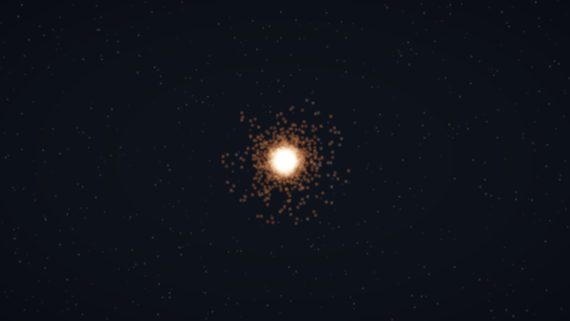
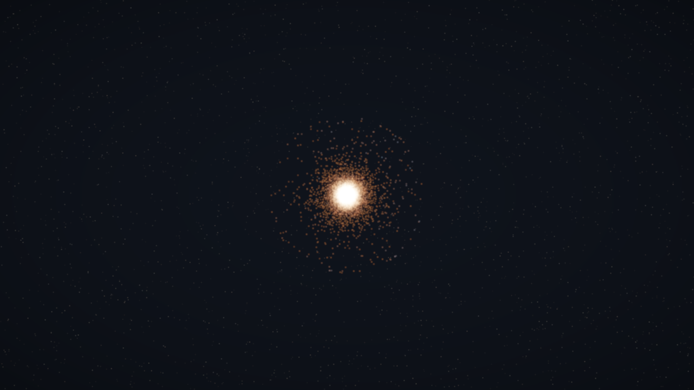
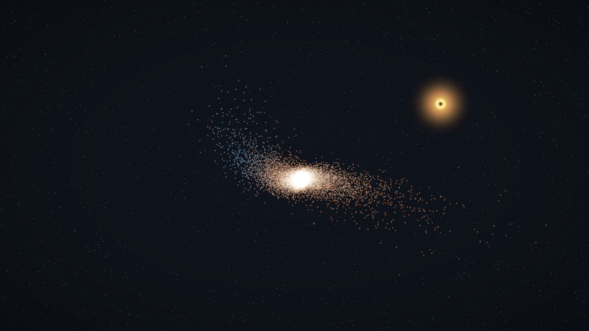
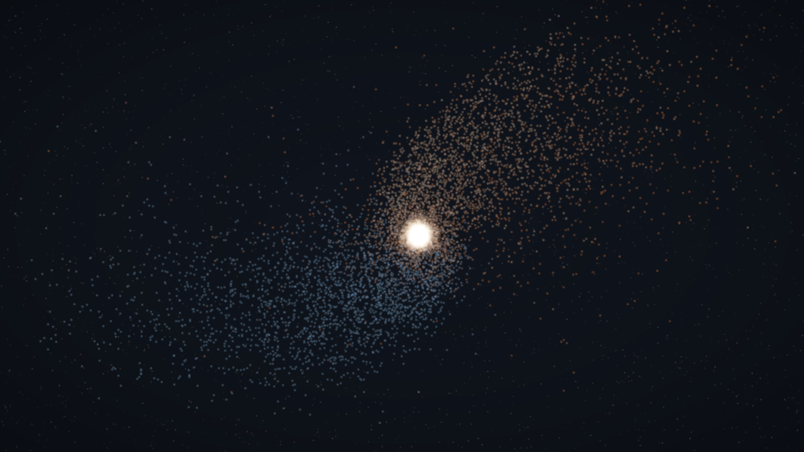
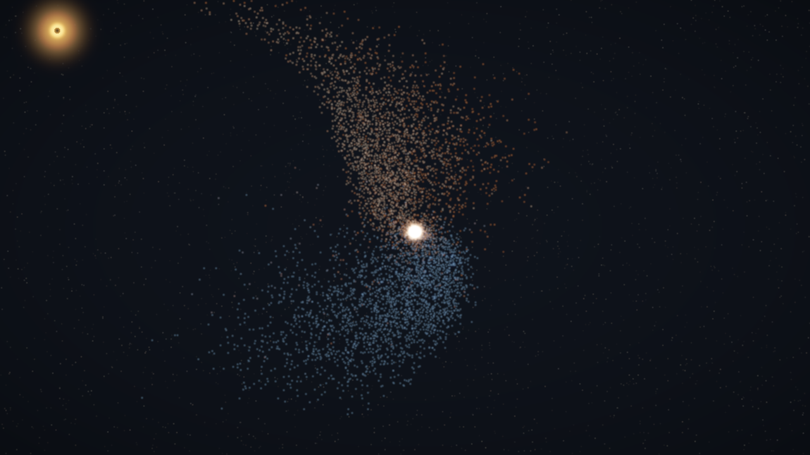
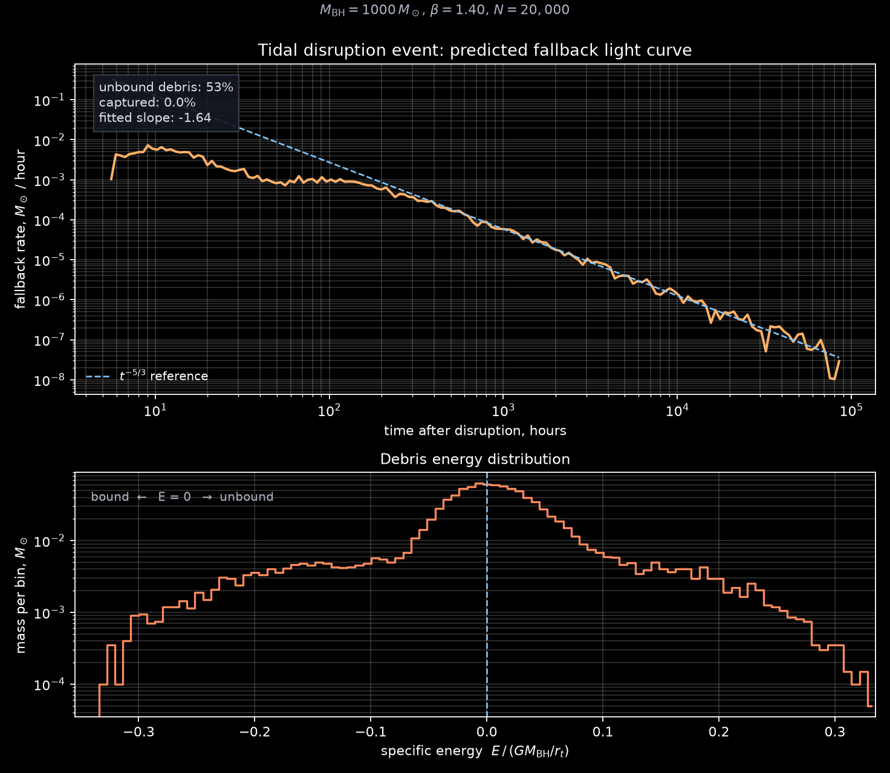
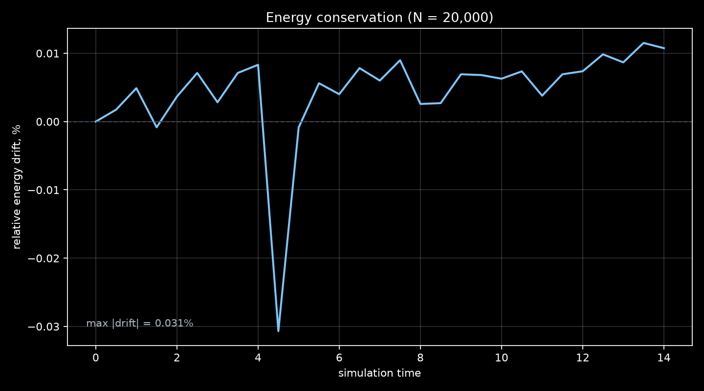

# Tidal Disruption — GPU N-body

[](https://github.com/Memovoff/tde-nbody/actions/workflows/tests.yml)

Симуляция приливного разрушения звезды чёрной дырой: звезда на параболической
орбите проходит перицентр, её оболочка срывается, часть вещества улетает,
часть остаётся связанной и возвращается. Гравитация считается прямым
суммированием на GPU, интегрирование — leapfrog, рендер — аддитивные частицы
с HDR и bloom. Отдельно строится кривая падения массы по распределению
энергий обломков.

Это самостоятельный репозиторий-сиквел к
[galaxy-nbody](https://github.com/Memovoff/galaxy-nbody) — там была та же
GPU-гравитация, но без внешнего поля чёрной дыры.



[Полное видео (MP4, ~7 МБ)](media/tde.mp4) · [Звезда до сближения](media/hero.png) · [Перицентр](media/periapsis.png) · [Поток обломков](media/stream.png) · [Поздняя стадия](media/final.png)

**Стек:** Python 3.10+, Taichi 1.7, NumPy, Matplotlib, Pillow, imageio/ffmpeg.
**Железо для цифр ниже:** NVIDIA GTX 1660 SUPER 6 GB, CUDA, Windows.

## Что внутри

- Звезда — Plummer-сфера, выборка из точной функции распределения; центр масс
  запускается по параболической орбите с перицентром
  $r_p = r_t/\beta$.
- Самогравитация звезды — прямое $O(N^2)$ суммирование с мягкой силой;
  чёрная дыра — внешний Plummer-сглаженный точечный потенциал.
- Симплектический leapfrog (kick-drift-kick): полная энергия не «уезжает».
- Радиус захвата у ЧД: частицы, упавшие внутрь, удаляются из динамики, но их
  масса и энергия сохраняются в отдельном резервуаре, чтобы диагностика
  оставалась честной.
- Цвет частиц: связанные обломки — тёплые, несвязанные — синие. Это не
  декорация: цвет считается по энергии относительно ЧД.
- Кривая падения: по удельной энергии каждого обломка находятся большая
  полуось и период возврата; гистограмма масс по периодам даёт
  $\dot M(t)$ и наклон в позднем режиме.
- Камера следует за звездой, автоматически расширяет кадр на перицентре и
  показывает поток обломков; можно вращать мышью.
- Headless-режим: превью, серии кадров, графики энергии и fallback-кривой,
  бенчмарки.
- Генерация MP4 и GIF без сохранения тысяч промежуточных PNG.
- Тесты физики, анализа и рендера.

## Кадры

| Звезда до сближения | Перицентр |
|---|---|
|  |  |

| Поток обломков | Поздняя стадия |
|---|---|
|  |  |

Кривая падения для прогона `N = 20 000`, `t = 14`:



Дрейф энергии за тот же прогон:



Максимальный относительный дрейф — **0.031%**, в конце — **0.011%**.

## Быстрый старт

```bash
git clone https://github.com/Memovoff/tde-nbody.git
cd tde-nbody
```

Windows (PowerShell):

```powershell
python -m venv .venv
.\.venv\Scripts\activate
python -m pip install -e ".[video]"
tde run
```

Linux/macOS:

```bash
python -m venv .venv
source .venv/bin/activate
pip install -e ".[video]"
tde run
```

Если команда `tde` недоступна, используйте `python -m tde run`.

### Управление

| Ввод | Действие |
|---|---|
| `Space` | пауза / продолжить |
| `R` или `Enter` | пересоздать начальные условия |
| стрелки | вращать камеру |
| зажать ЛКМ и вести мышью | вращать камеру |
| `F` | включить / выключить слежение за звездой |
| `Z` / `X` | приблизить / отдалить |
| `+` / `-` | скорость симуляции (шагов на кадр) |
| `Esc` | выход |

### Headless

```powershell
tde headless --n 20000 --steps 5600 `
  --frames-dir media/frames --frame-every 16 `
  --out media/final.png `
  --fallback-csv media/fallback.csv `
  --fallback-plot media/fallback.png `
  --energy-csv media/energy.csv
```

`--steps 5600` при `dt = 0.0025` — это `t = 14`, примерно 6.2 часа
физического времени. Кадры можно потом собрать в видео или GIF.

### Видео и GIF

```powershell
python scripts/render_video.py `
  --n 20000 --steps 4800 --frame-every 14 --fps 30 `
  --width 1280 --height 720 --out media/tde.mp4

python scripts/render_gif.py `
  --n 10000 --steps 4800 --frame-every 32 --fps 12 `
  --width 640 --height 360 --out media/preview.gif
```

Оба скрипта считают симуляцию заново, рендерят кадры и сразу кодируют их,
не создавая промежуточные PNG на диске.

### Бенчмарк

```powershell
tde bench --sizes 5000 20000 50000
```

## Физика

Единицы: `G = 1`, масса — в массах Солнца, длина — в радиусах Солнца, время —
в звёздном динамическом времени

$$
t_* = \sqrt{\frac{R_\odot^3}{G M_\odot}} \approx 26.5\ \text{мин}.
$$

По умолчанию:

- $M_\mathrm{BH} = 10^3\,M_\odot$ — промежуточная чёрная дыра;
- $M_* = 1\,M_\odot$, $R_* = 1\,R_\odot$;
- $r_t = R_*(M_\mathrm{BH}/M_*)^{1/3} = 10\,R_\odot$;
- $\beta = r_t/r_p = 1.4$, то есть $r_p = 7.14\,R_\odot$;
- старт с $r_0 = 4r_t = 40\,R_\odot$.

Ускорение частицы:

$$
\mathbf{a}_i =
\sum_{j \ne i} G m_j
\frac{\mathbf{r}_j - \mathbf{r}_i}
{\left(|\mathbf{r}_j - \mathbf{r}_i|^2 + \epsilon^2\right)^{3/2}}
-
\frac{G M_\mathrm{BH}\,\mathbf{r}_i}
{\left(|\mathbf{r}_i|^2 + \epsilon_\mathrm{BH}^2\right)^{3/2}}.
$$

Интегратор — leapfrog (KDK):

$$
\mathbf{v} \leftarrow \mathbf{v} + \frac{\Delta t}{2}\mathbf{a}, \quad
\mathbf{x} \leftarrow \mathbf{x} + \Delta t\,\mathbf{v}, \quad
\text{пересчёт } \mathbf{a}, \quad
\mathbf{v} \leftarrow \mathbf{v} + \frac{\Delta t}{2}\mathbf{a}.
$$

### Кривая падения

Для каждого выжившего обломка считается удельная энергия относительно ЧД:

$$
E = \frac{v^2}{2} - \frac{G M_\mathrm{BH}}{\sqrt{r^2 + \epsilon_\mathrm{BH}^2}}.
$$

Для связанных обломков ($E < 0$):

$$
a = -\frac{G M_\mathrm{BH}}{2E}, \qquad
P = 2\pi\sqrt{\frac{a^3}{G M_\mathrm{BH}}}.
$$

Гистограмма массы по $P$ даёт прогноз темпа падения $\dot M(t)$. В позднем
режиме для однородного распределения энергии ожидается
$\dot M \propto t^{-5/3}$. В этом прогоне измеренный наклон — **−1.64**
(теория — −1.67), медианный период возврата — **194 ч** (~8 суток).

Важно: симуляция прослеживает только сближение и формирование потока
(первые ~6 часов). Возврат обломков занимает от часов до лет, поэтому
fallback-кривая — это прогноз по распределению энергий, а не результат
досчёта до аккреции.

### Что происходит в прогоне

- Несвязанными оказываются **52.5%** массы звезды, связанными — **47.5%**.
- Прямых падений в радиус захвата при $\beta = 1.4$ нет: `captured = 0`.
  Поток проходит мимо ЧД, а не прошивает её.
- Синие частицы на кадрах — несвязанные обломки, оранжевые — связанные.
- Энергия сохраняется до **0.031%**; всплеск ошибки приходится на перицентр,
  где ускорения максимальны.

## Производительность

Прямое суммирование, только шаги симуляции, без рендера (после `ti.sync()`):

| N | шагов/с | млрд парных взаимодействий/с |
|---:|---:|---:|
| 5 000 | 858 | 21.5 |
| 20 000 | 191 | 76.3 |
| 50 000 | 42.6 | 106.6 |

Headless-прогон `N = 20 000`, 5600 шагов с рендером 351 кадра занял ~50 с
(111 шагов/с с учётом камеры и PNG). Чистые шаги — быстрее, см. таблицу.

Это честный потолок $O(N^2)$ на GTX 1660 SUPER. Для $10^6$ частиц нужен
Barnes-Hut или particle-mesh — это следующий шаг.

## Тесты

```powershell
pytest
```

Проверяется:

- ускорение совпадает с NumPy-эталоном (включая внешнюю ЧД),
- начальные условия: центр масс, импульс, нулевая энергия параболической
  орбиты,
- Plummer-звезда близка к вириальному равновесию,
- энергия сохраняется до перицентра,
- захват частицы уменьшает массу, пишет энергию в резервуар и гистограмму,
- fallback-кривая физична: доли в [0, 1], положительные времена, конечный
  наклон,
- рендер возвращает конечное изображение нужной формы.

## Структура

```text
src/tde/
  config.py             параметры, единицы, r_t и r_p
  initial_conditions.py Plummer-звезда и параболическая орбита
  core.py               Taichi-ядра, leapfrog, захват, энергия
  analysis.py           энергии, fallback-кривая, графики
  render.py             камера, splatting, ЧД, bloom, tone mapping
  app.py                интерактивное окно
  headless.py           превью, кадры, диагностика, бенчмарк
  cli.py                команды tde run/headless/bench
scripts/
  render_video.py       симуляция → MP4
  render_gif.py         симуляция → GIF
tests/
  test_physics.py
  test_analysis.py
  test_render.py
media/
  hero.png              звезда до сближения
  periapsis.png         перицентр
  stream.png            поток обломков
  final.png             поздняя стадия
  fallback.png          кривая падения
  energy.png            дрейф энергии
  preview.gif           превью для README
  tde.mp4               полное видео
```

## Что показывает проект

- GPU-ядра на Taichi: самогравитация $O(N^2)$ плюс внешний потенциал.
- Численные методы: softened gravity, symplectic leapfrog, контроль энергии,
  резервуар для аккрецированных частиц.
- Научный постпроцессинг: распределение энергии, периоды возврата,
  fallback-кривая и сравнение с $t^{-5/3}$.
- Рендер с нуля: 3D-проекция, HDR-буфер, bloom, tone mapping, следящая
  камера и цвет по связанности обломков.
- Инженерная упаковка: CLI, пакет, тесты, бенчмарки, воспроизводимые
  эксперименты, видео и GIF.

## Ограничения и планы

- **$O(N^2)$** — основной предел. Следующий шаг: Barnes-Hut (Morton-коды,
  обход октодерева) или particle-mesh с FFT для $10^6$ частиц.
- Нет общей теории относительности: только ньютоновский потенциал и
  Plummer-сглаживание. Прецессия перицентра и горизонт событий не
  моделируются.
- Звезда — набор гравитирующих частиц, без гидродинамики, ударных волн и
  radiative transfer. Для реалистичного разрушения нужен SPH или mesh-код.
- Аккреция — только сток с радиусом захвата; аккреционного диска и излучения
  нет. Fallback-кривая — прогноз, а не самосогласованная светимость.
- Нет вращения звезды, магнитных полей и тёмного гало.
- Масса ЧД $10^3\,M_\odot$ выбрана, чтобы звезда была разрешима 20 000
  частицами. Модель масштабно-инвариантна; для реальной SMBH можно увеличить
  $M_\mathrm{BH}$, но понадобится больше частиц или адаптивное softening.
- Камера следует за обломками, поэтому на поздних кадрах ЧД уходит из кадра.
  Это осознанный компромисс: иначе звезда и поток становятся слишком мелкими.

## Лицензия

MIT. См. [LICENSE](LICENSE).
